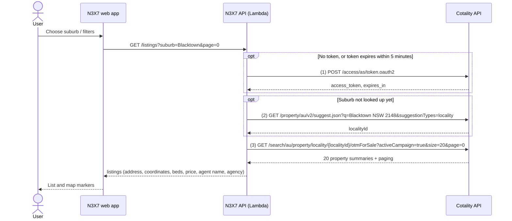
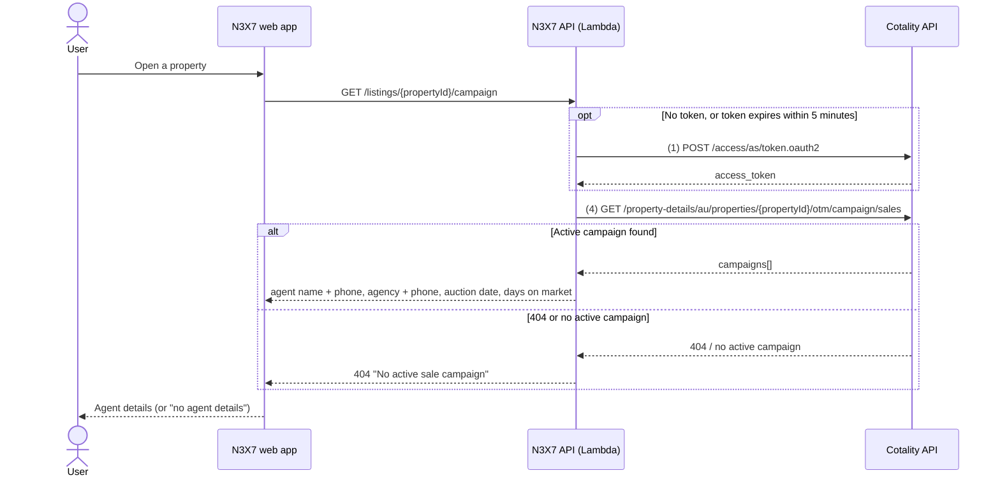

# Cotality API Call Flow: N3X7

_Last updated 29 October 2026. Source of truth: `api/src/cotality.ts`, `api/src/routes.ts`, `api/src/map.ts`._

## 1. Purpose and scope

This document lists every Cotality (formerly CoreLogic) API endpoint the N3X7 app calls, in the order it calls them, and the endpoints we plan to add.

- **Environment:** Cotality sandbox, `https://api-sbox.corelogic.asia`.
- **Coverage:** the sandbox has data for three NSW suburbs only: Blacktown, Quakers Hill and Seven Hills.
- **Auth:** OAuth 2.0 client credentials (application-level). We do not use the RP.Inside user login.

## 2. How a call travels

```
Browser (N3X7 app)
   │  HTTPS + Cognito ID token
   ▼
AWS API Gateway (HTTP API, Cognito JWT authorizer, throttled to 10 requests/second)
   │
   ▼
AWS Lambda (n3x7-api)  ── reads client ID/secret from AWS Secrets Manager (n3x7/cotality)
   │  HTTPS + Cotality Bearer token
   ▼
Cotality API (api-sbox.corelogic.asia)
```

The browser never calls Cotality directly and never sees the Cotality credentials or token. Our API exposes two routes:

| Our route | Triggered when | Cotality calls behind it |
|---|---|---|
| `GET /listings?suburb=&types=&minLandArea=&page=` | The user opens the Live list or map, changes suburb or filters, or pages | 1 → 2 → 3 |
| `GET /listings/{propertyId}/campaign` | The user opens a property's details drawer | 1 → 4 |

## 3. Sequence

### Flow A: load the list of properties for sale



### Flow B: get agent information for one property



## 4. Endpoints in use today

| # | Method and path | Purpose | Key parameters | Fields we use | When / caching |
|---|---|---|---|---|---|
| 1 | `POST /access/as/token.oauth2?grant_type=client_credentials` | Get an access token | HTTP Basic auth with client ID and secret | `access_token`, `expires_in` | Before any data call. Reused until 5 minutes before expiry, per Lambda instance. Fetched again once if a data call returns 401. |
| 2 | `GET /property/au/v2/suggest.json` | Turn a suburb name into a Cotality `localityId` | `q` (e.g. `Blacktown NSW 2148`), `suggestionTypes=locality` | `suggestions[].localityId` where `suggestionType = locality` | Once per suburb per Lambda instance, then cached. |
| 3 | `GET /search/au/property/locality/{localityId}/otmForSale` | **Property sales data:** properties currently for sale in a suburb | `activeCampaign=true`, `size=20`, `page`, optional `pTypes` (HOUSE, UNIT, LAND), optional `landArea` (`{min}-`) | `propertySummary`: `id`, `coordinate`, `address.singleLineAddress`, `propertyType`, `attributes` (bedrooms, bathrooms, carSpaces, landArea), `propertyPhoto.mediumPhotoUrl`, `otmForSaleDetail` (priceDescription, method, date, **agent**, **agency**); `page.totalPages`, `page.totalElements` | Every list load, filter change or page change. Not cached. |
| 4 | `GET /property-details/au/properties/{propertyId}/otm/campaign/sales` | **Property details data:** the active sale campaign, including agent contact details | `propertyId` from call 3 | Active entry of `forSalePropertyCampaign.campaigns[]`: `agent.agent`, `agent.phoneNumber`, `agency.companyName`, `agency.phoneNumber`, `priceDescription` / `latestAdvertisementPrice`, `auctionDate`, `daysOnMarket` | Each time a property drawer opens. Not cached. |

Without `activeCampaign=true`, call 3 also returns old listings back to 2007, so we always send it.

## 5. How we get agent information

Agent information comes from two calls, in this order:

1. **Call 3 (search)** gives the agent's **name** and the **agency name** for every listing, so the list can show them without extra calls.
2. **Call 4 (campaign)** is made only when the user opens one property. It adds the **agent's phone number**, the **agency's phone number**, the auction date and days on market. We take the campaign where `isActiveCampaign = true`.

In the sandbox, campaign data lags behind search, so call 4 sometimes returns 404 for a property that call 3 listed. The app then shows that no agent details are available.

## 6. Planned endpoints (to be confirmed with Cotality)

These are not called yet. Paths are to be confirmed against Cotality's API documentation and our subscription.

| Method and path | Purpose | Planned use |
|---|---|---|
| `GET /property-details/au/properties/{propertyId}/attributes/core` | **Property details:** core attributes (property type, beds, baths, car spaces, land and floor area) | Fuller property facts in the property drawer |
| `GET /property-details/au/properties/{propertyId}/sales` | **Property sales history:** past sales with dates and prices | Sales history and price trend in the property drawer |

Both would use the same token (call 1) and the `propertyId` from call 3, and would run when a property drawer opens, alongside call 4.

## 7. Errors and limits

| Cotality response | What the app does | What our API returns |
|---|---|---|
| 401 on a data call | Gets a new token and retries once | Data if the retry succeeds; otherwise 502 |
| Token request fails | Stops | 502 "Cotality authentication failed" |
| 429 on any call | Stops | 503 "Cotality quota exceeded, try later" |
| 404 on call 4 | Treats it as no active campaign | 404 "No active sale campaign" |
| Any other error | Stops | 502 "Cotality unavailable" |

API Gateway limits our API to 10 requests per second, which also caps how fast we call Cotality. Each request to our API is logged with its route, status and duration (no personal data).
